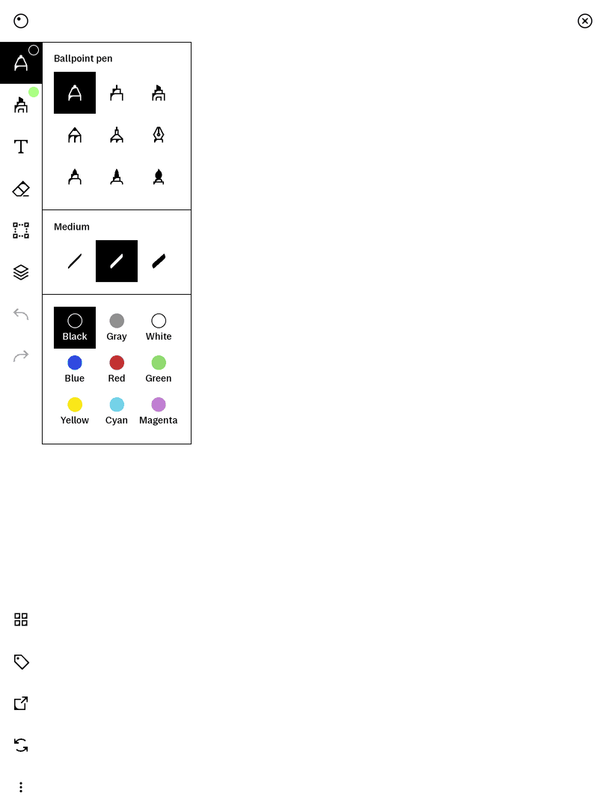

# rmpp-textobj

**Text objects for the reMarkable Paper Pro**: typed text drawn as ordinary pen strokes in a clean stroke font, that
you can move, resize, copy and erase like handwriting, and edit as text with a double tap. Runs without xovi and
keeps working after a reboot.

Made for and tested on the reMarkable Paper Pro with OS 3.29. Other reMarkable models are not supported.
Updates for newer OS versions may take some time to follow.

> Part of the **rmpp add-ons**, built on [rmpp-packages](https://github.com/lorancecall/rmpp-packages): it is
> installed by rmpp setup, loaded into xochitl at every boot by rmpp-preload (no xovi), and kept up to date with
> Vellum. How that differs from xovi: [how it works](https://github.com/lorancecall/rmpp-packages/blob/main/docs/how-it-works.md).
>
> Status: experimental.

## Install

Start at **[rmpp-packages](https://github.com/lorancecall/rmpp-packages#install)**: it explains developer mode and
has **rmpp setup**, the installer for all rmpp add-ons.

- In rmpp setup (the desktop app or the script), tick **Text objects (beta)** (rmpp-textobj; not selected by
  default; **Handwriting recognition (beta)** brings it too), and the rmpp-lang languages whose glyphs you need.
- It installs `rmpp-lang` and `rmpp-preload` with it ([all packages and dependencies](https://github.com/lorancecall/rmpp-packages/blob/main/docs/packages.md)).
- After a reMarkable OS update: **Restore** in rmpp setup.
- Without rmpp setup, removing it, next to other mods, building it: [docs/install.md](docs/install.md).

## Use

- **Add text object** (T tool menu): tap where the text goes, type, OK; the new object is selected to move it.
- **Edit**: double tap an object with a finger: it is selected and its text, weight and size open for editing
  (Cancel leaves it selected to move).
- **Always whole**: lasso, move, copy and delete act on whole objects; erasing part of one makes it plain strokes.
- **Highlights** snap to the characters as a band that goes with the object and comes back on the same characters
  after an edit; in the edit box, a Highlight button turns them on and off per character. Underlines and other
  handwriting stay separate.
- **Handwriting to text objects**: [rmpp-hwr](https://github.com/lorancecall/rmpp-hwr)'s lasso convert.

Details: [docs/usage.md](docs/usage.md).

## How it works

Loaded into xochitl by rmpp-preload, it draws text with the glyphs of [rmpp-lang](https://github.com/lorancecall/rmpp-lang)'s
language add-ons (this package has ASCII only; text with characters no installed language has is refused, naming
them). Each object carries its own record inside its strokes, so it is found wherever it was moved, scaled or
copied, syncs with the page and can be edited on another tablet with this add-on; without it, it is plain handwriting.
The code and its tests: [docs/develop.md](docs/develop.md).

## Build

[docs/install.md#build-and-install-by-hand](docs/install.md#build-and-install-by-hand).

## License

GPL-3.0 (see LICENSE). `data/glyphs.json`: glyph centre lines derived from Noto Sans KR, SIL Open Font License 1.1
(see NOTICE and data/OFL-NotoSansKR.txt).
